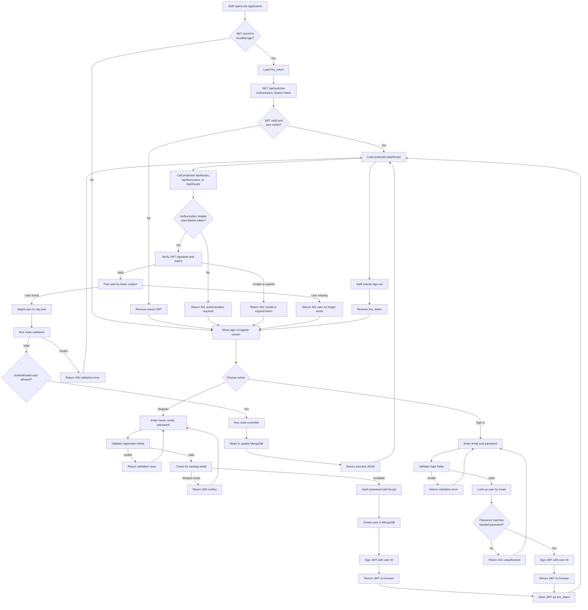
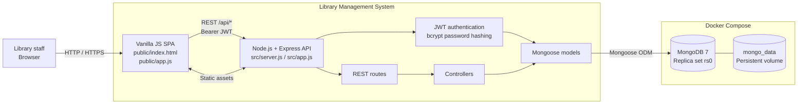
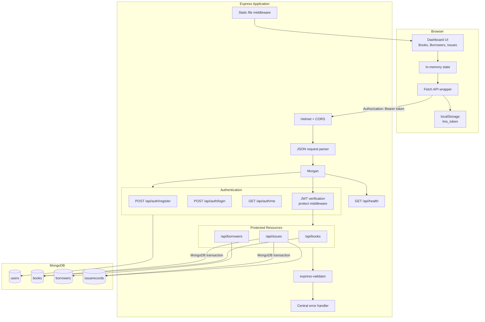
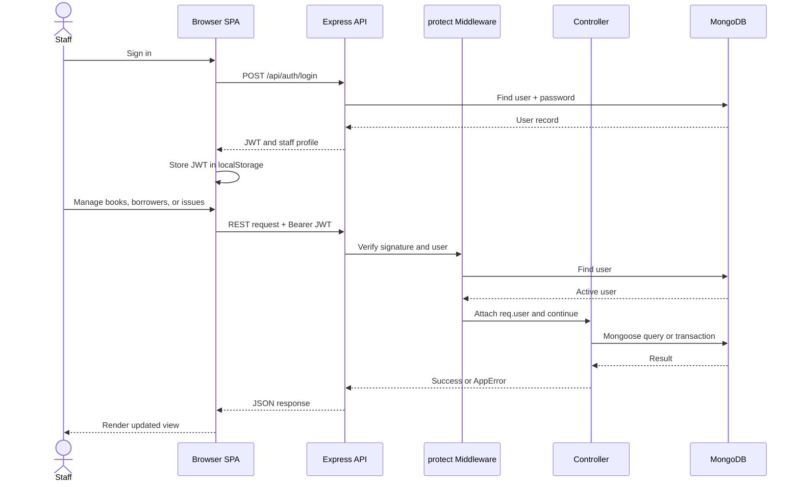
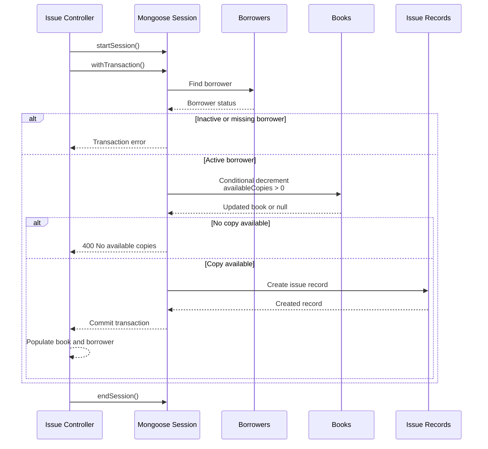
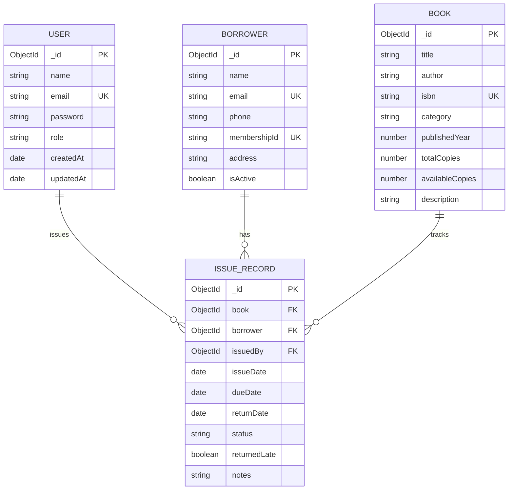

# Library Management System Architecture

## Authentication and Authorization Workflow

### Authorization Rules

- Authentication is enforced by the `protect` middleware on `/api/books`, `/api/borrowers`, and `/api/issues`.
- `/api/auth/register` and `/api/auth/login` are public.
- The JWT contains the authenticated user's ID and expires after `JWT_EXPIRES_IN`, defaulting to `7d`.
- Protected routes verify the JWT, then load the current user and attach it to `req.user`.
- The application currently treats every authenticated user as authorized for every protected operation.
- Although `User.role` supports `librarian` and `admin`, no role-based authorization middleware or role check is currently enforced.

## System Context

## Application Layers

## Request Flow

## Issue and Return Transaction Flow

Returning a book uses the same transaction pattern:

1. Load the issue record.
2. Reject it if it is already returned.
3. Set `returnDate`, `status`, and `returnedLate`.
4. Increment `availableCopies` only while it remains below `totalCopies`.
5. Commit both updates atomically, or roll back on failure.

## Data Model

## Deployment Notes

- `src/server.js` connects to MongoDB before starting the Express listener.
- The default HTTP port is `5000`.
- Express serves the browser SPA from `public/` and provides `/api/*` routes.
- MongoDB runs as the `rs0` replica set because circulation operations use MongoDB transactions.
- Docker Compose persists MongoDB data in the `mongo_data` volume.
- The frontend keeps the JWT in `localStorage` and adds it to protected API requests.
- Validation errors, Mongoose validation/cast errors, duplicate keys, and application errors pass through the central error middleware.
